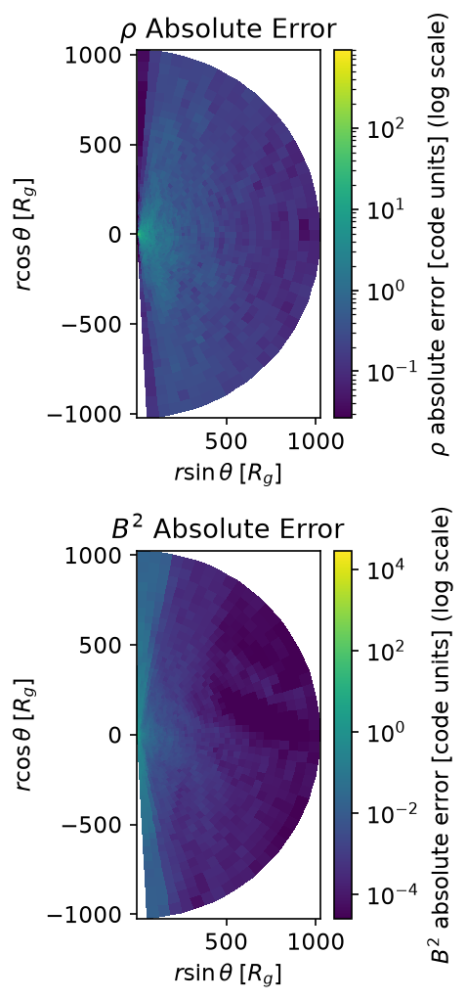
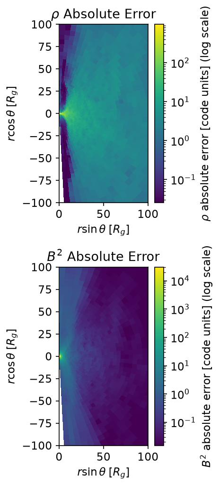
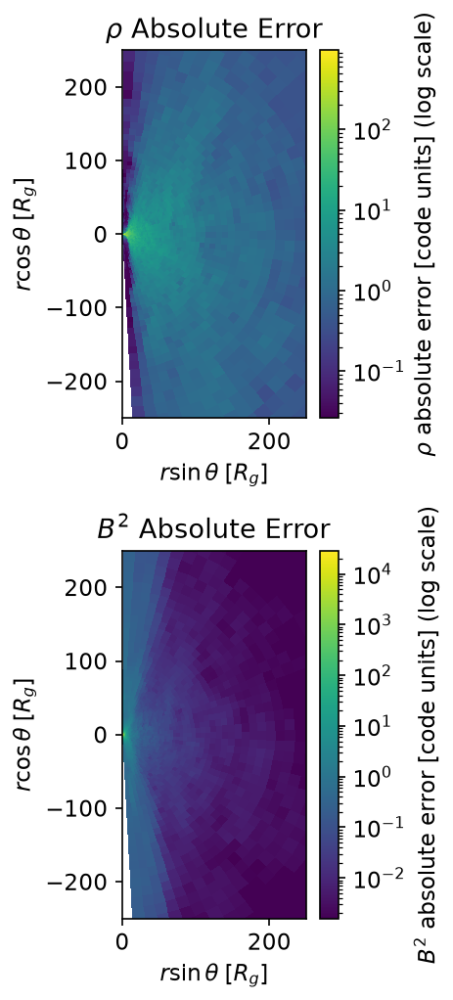
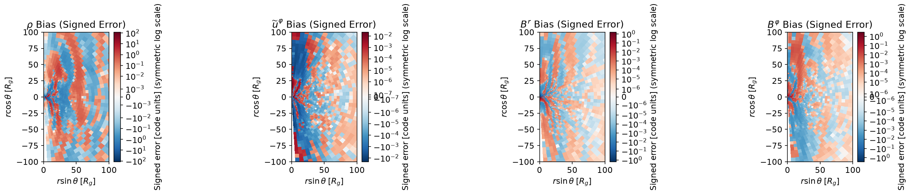
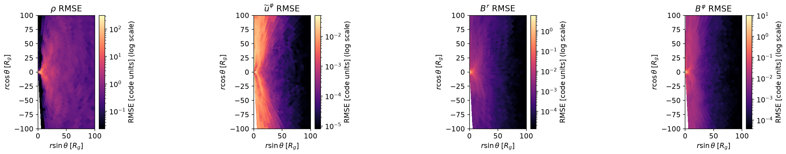
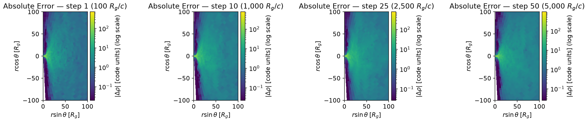

# Error-map colour-scale review

Presentation-only follow-up to milestone 4. Absolute-error and RMS maps use LogNorm with positive-value 1st/99.5th percentiles measured inside the displayed region. Signed bias uses SymLogNorm centred on zero. Colourbars retain units and identify the scale; zero/missing values and degenerate ranges are explicit.

Checks, rendering, verified owner-reference refresh and crop export executed sequentially in interactive allocation `3616371`, `ghx4-interactive`, account `bgun-dtai-gh`. No inference or milestone-5 implementation is part of this change.

## Numerical and contrast checks

| Dataset | Unchanged full result fingerprint | Maps | Largest lowest-5%-colour occupancy |
|---|---|---:|---:|
| rc300_reduced_v1 | `aaf9b231403803169969957437cbae66c4f3e22f2fc54df4e986a750ccbf212b` | 18 | 6.76% |
| 5000run_v1 | `0b14cbc81327d0ae065b61a68817368833ab440b096a00301e4f6a3fe8baea36` | 18 | 5.78% |

All visible nonconstant maps pass the 90% occupancy limit. Occupancy counts coloured finite cell values inside the view; logarithmically undefined zero pixels are uncoloured. Constant/empty maps are labelled rather than given artificial variation. Percentile calibration and field values are unchanged by crop export.

## Tests

- `gval-error-map-tests.log`: 15 tests passed in 83.539 s.
- `gval-error-map-tests-numpy124.log`: 15 tests passed in 88.178 s.
- `gval-error-map-full-suite.log`: 108 tests passed in 483.958 s.

The regression deliberately applies the previous linear scale to a synthetic map with large horizon outliers and verifies that the occupancy guard fails. Additional tests check visible-region percentiles, signed symmetry, zero/constant maps, all affected figure variants, axes, units and colourbars. Both NumPy 2.5.4 and 1.24.4 are exercised. Final doctor passes.

## Review crops

rc300 validation, mean over the existing protocol starts. Crops retain axes and colourbars; the full-size figures and all map audits are in the presentation bundles below.
The fig08 crops show step 50 (5,000 R_g/c); fig14 shows one-step bias/RMS;
fig16 retains the step and elapsed-time labels on every panel.

All six attached crops were visually inspected after rendering. The fig08
variants expose their local error structure, the RMS row spans its physical
dynamic range, and signed bias retains both signs around zero.

### Fig 08 — full-domain absolute errors

### Fig 08 — r100 absolute errors

### Fig 08 — r250 absolute errors

### Fig 14 — signed bias

### Fig 14 — RMS errors

### Fig 16 — absolute-error row

## Presentation bundles

- rc300_reduced_v1: `/work/nvme/bgun/share/validation/reports/rc300_reduced_v1/figure-review-49300a663cb7`.
- 5000run_v1: `/work/nvme/bgun/share/validation/reports/5000run_v1/figure-review-53a0ff1f743f`.

Each bundle records unchanged source result fingerprints, renderer/output hashes, per-panel visible-region bounds and contrast measurements, all 22 full-tier PNGs and six review crops. Owner-reference PNGs were refreshed atomically through the fingerprint-verified path.

Milestone 5 remains pending owner review of this figure fix.
