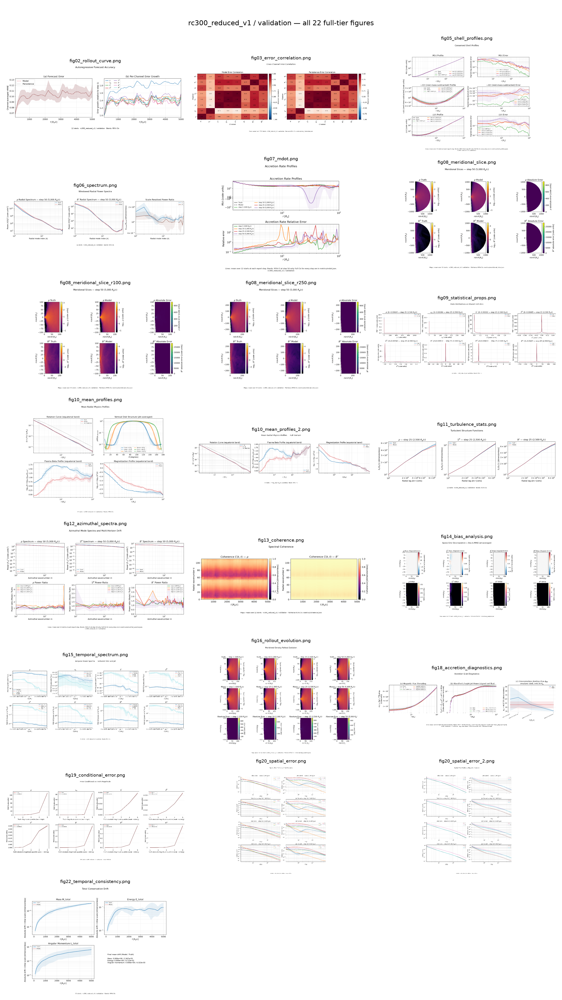
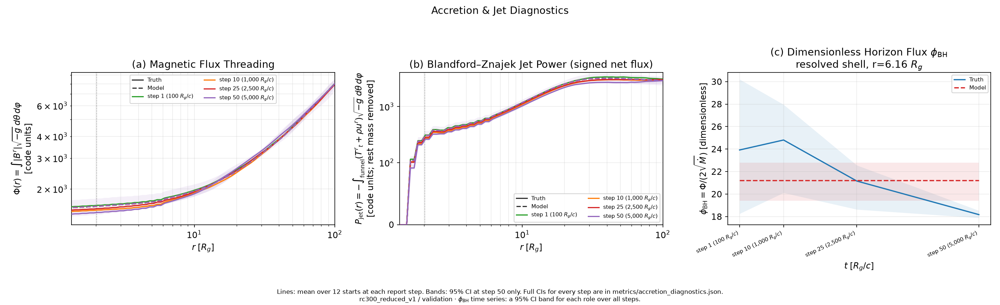

# Milestone 4 validation and presentation receipt

Both datasets pass quick and full persistence conformance with identical result-content fingerprints. The 5000run OOM is resolved within the original 64 GB requests. Aggregate figures retain the physics designs and use final-step-only CI shading for multi-step overlays.

## Identity

Protocol SHA256: `74d6f91071413ccc7154770312ea40b2d2c007225d094b0a2bbfba383e3a93e2`.
Platform: `deltaai-aarch64`; locked environment SHA256: `35994d88a30a821cac354665ffee35adfc0a5090fe9052d27816d6c241bad525`.
Training-only channel scales and moments: [channel-scales receipt](milestone_4_channel_scales.md).

## Fingerprints and timings

| Dataset | Tier | Reference fingerprint | Reference seconds | Conformance |
|---|---|---|---:|---|
| rc300_reduced_v1 | quick | `6d8ecd5d35dcd85c89796e25fddb53bffcc55611f26f833c2168da0fcb815ec6` | 292.138 | exact; largest relative difference 0 |
| rc300_reduced_v1 | full | `aaf9b231403803169969957437cbae66c4f3e22f2fc54df4e986a750ccbf212b` | 1643.550 | exact; largest relative difference 0 |
| 5000run_v1 | quick | `cd9598fd3f8380f9ebc862db46eb42d070fcfc7f43e532e7bd0f9fc7c51cf648` | 671.842 | exact; largest relative difference 0 |
| 5000run_v1 | full | `0b14cbc81327d0ae065b61a68817368833ab440b096a00301e4f6a3fe8baea36` | 4730.422 | exact; largest relative difference 0 |

Combined quick/full conformance for rc300_reduced_v1: 1886.743 s.
Combined quick/full conformance for 5000run_v1: 4087.671 s.

## Slurm memory

| Allocation/step | Work | sacct MaxRSS | GiB |
|---|---|---:|---:|
| 3614828.0 | rc300 quick/full references + conformance, and short 5000run profile | 5710976K | 5.446 |
| 3615305.0 | 5000run quick/full references | 6068672K | 5.788 |
| 3615576.0 | 5000run quick/full conformance; initial follow-on figure tests | 6375808K | 6.080 |

These are conservative step-wide upper bounds for the reference/conformance commands. The 5000run reference and conformance are each below 48 GB. All requests remained at 64 GB. Step 3615576 completed numerical conformance successfully, then its first follow-on presentation tests failed on undefined log curves; the final presentation checks below cover that corrected edge case.

Job 3611323 previously hit OOM at 65946.50M. The process/cgroup diagnostic found about 20 GB of file cache alongside about 8 GB of anonymous memory. The fix combines float32 disk-backed replay, local float64 reductions, start-wise cycle collection, incremental SQLite commits, and releasing clean sequential-I/O pages after synchronized scratch writes.

## Short 5000run profile

Three protocol starts in diagnostic-only shortened windows; all 25 analyses completed, including truth/persistence cache construction. The diagnostic never publishes benchmark results. RSS is sampled from /proc at 20 ms; the Slurm cgroup sampler includes file cache. Invocation-owned profile artifacts are removed after recording the receipt.

| Analysis | Three-start peak process RSS (GiB) | Full 12-start reference peak process RSS (GiB) |
|---|---:|---:|
| accretion_diagnostics | 1.717 | 1.763 |
| azimuthal_spectra | 2.248 | 2.223 |
| bias_analysis | 2.256 | 3.436 |
| coherence | 2.251 | 2.264 |
| conditional_error | 2.045 | 2.080 |
| conservation_closure | 2.113 | 2.018 |
| correlation_times | 1.604 | 2.000 |
| cost | 1.934 | 1.581 |
| error_correlation | 1.427 | 1.848 |
| lorentz | 2.104 | 2.032 |
| mdot | 2.118 | 2.047 |
| mean_profiles | 2.153 | 2.081 |
| meridional_slice | 2.084 | 2.971 |
| physics_table | 3.330 | 3.109 |
| rollout_curve | 1.504 | 1.769 |
| rollout_evolution | 2.294 | 3.583 |
| shell_profiles | 2.273 | 2.048 |
| single_step | 1.493 | 1.853 |
| spatial_error | 2.137 | 2.384 |
| spectrum | 2.316 | 2.204 |
| stability | 2.704 | 2.304 |
| statistical_props | 2.032 | 2.100 |
| temporal_consistency | 2.403 | 2.184 |
| temporal_spectrum | 4.726 | 4.747 |
| turbulence_stats | 2.105 | 2.085 |

| Cache-build scope | Peak process RSS (GiB) |
|---|---:|
| attractor_sigma | 1.439 |
| azimuthal_spectra | 2.134 |
| conditional_baseline | 1.904 |
| conditional_edges | 1.824 |
| correlation_time | 1.747 |
| histogram_edges | 2.032 |
| kernel | 3.203 |
| mean_profiles | 2.100 |
| persistence_physical_relative | 1.287 |
| persistence_rollout | 1.536 |
| persistence_single | 1.493 |
| spectrum_mask | 2.316 |
| structure_functions | 2.105 |
| structure_s2 | 2.105 |
| temporal_spectrum | 4.726 |
| transport | 2.113 |

The synthetic large-grid test replays 32 frames on an 8 × 128 × 64 × 32 grid for one versus eight starts. It retains only reduced channel means, verifies float32 states, and rejects eager rollout materialization. Measured traced peaks were 25,214,174 bytes and 25,300,518 bytes (one field: 8,388,608 bytes). The field working set is bounded; reduced result rows and bookkeeping remain proportional to the requested output.

## Tests

Before the presentation update: 96/96 tests passed with NumPy 2.5.4 and NumPy 1.24.4. The real pinned persistence and TRON legacy regressions each passed 226,552 comparisons at the approved 1e-5 relative tolerance.

The full 100-test suite and the additional targeted checks below pass. Presentation checks They cover every full-tier PNG, raw-label/unlabeled-axis rejection, actual step/time labels, matched role/step styles, band counts, empty log curves, fixed dimensions and doctor candidate reporting.

## Candidate cleanup

Doctor reported `/work/nvme/bgun/share/validation/references/rc300_reduced_v1/forecast_v1/74d6f91071413ccc7154770312ea40b2d2c007225d094b0a2bbfba383e3a93e2/persistence_full/.candidate-a4711ea224e84bebb642da9c9c0ac1c2` as unfinished before cleanup. Its owner, host, incomplete metadata and absence of COMPLETE/golden.json matched the cancelled unpublished attempt. Removed 3,181 invocation-owned entries (30,662,823,750 bytes). The storage check changed from warn to pass, with no unfinished reference candidates. The regression test covers this exact nested protocol-hash path.

## Figure review

All report-step means remain visible in multi-step overlays. Truth is solid, model dashed, with one shared colour per step; only the final step has light, outline-free bands. The dimensionless-flux time series retains both role bands over steps. Captions name the split/start count, identify displayed bands and point to complete metric CIs.

Presentation bundle: `/work/nvme/bgun/share/validation/reports/rc300_reduced_v1/figure-review-acf5fe1b064a`.
Source result fingerprint verified before and after rendering: `aaf9b231403803169969957437cbae66c4f3e22f2fc54df4e986a750ccbf212b`.
Contact sheet SHA256: `2662cf1970ae6036af3151bb29e12b62fadb7a3dd1c32172dc35064cdc38b236`.
The bundle includes full-size PNGs, figure_labels.json (physics axes, scales, legends and interval counts), and presentation.json (source/renderer/output hashes).

All 22 full-tier PNGs were re-rendered for both datasets. Their owner persistence
references now contain the corrected images, with image hashes in
figures/presentation.json. Numerical golden fingerprints remain unchanged.
The contact sheet and fig18 were visually inspected after the final radial-limit
adjustment. Figure tests and rendering ran sequentially in interactive job
3615887; the final doctor verdict is pass.

Final `gval-figure-tests.log`: 9 tests passed in 71.387 s.
Final `gval-figure-tests-numpy124.log`: 9 tests passed in 72.030 s.
Final `gval-figure-full-suite.log`: 100 tests passed in 478.609 s.
Final `gval-reference-presentation-tests.log`: 4 tests passed in 6.344 s.
