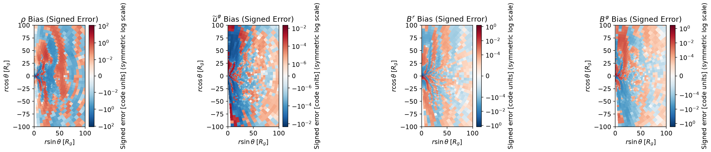
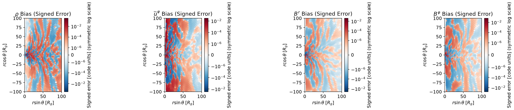

# Milestone 5 validation receipt

Branch: `milestone-5-adapters-predictions`, based on merged PR #5 (`ff9c8cf`).
PR: https://github.com/YongseokJo/grmhd-emulator-validation/pull/6

Delivered: credited TRON/ViT and Eden Claude/GPT/Gemini adapters, checkpoint
training declarations with computed overlap, task/packet create/advance/collect,
strict prediction-file scoring through the existing analysis modules, immutable
prompts, provenance/attestation and role-specific instructions. Spec formats and
the owner's §9 refinements were committed separately before implementation.
No dependencies, frozen splits or protocol settings changed. See
[milestone scope](milestone_5.md) and [port provenance](provenance.md).

## Checks

All numerical/figure tests ran through Slurm on `ghx4-interactive`, account
`bgun-dtai-gh`. No owner job was cancelled. Job 3616562 completed in 11m36s
(step 11m29s), MaxRSS 4,591,488 K from sacct, with a 32 GB allocation.

| Check | Result |
|---|---|
| Full native suite (NumPy 2.5.4) | 130 passed, 537.935 s |
| Targeted minimum environment (NumPy 1.24.4) | 24 passed, 41.567 s |
| Real pinned TRON forward/decode regression | Pass, 5.024 s, maximum relative difference **0** |
| Final native/minimum audit checks | 25 passed on each: NumPy 2.5.4, 53.545 s; NumPy 1.24.4, 43.557 s |
| Final doctor | Pass, locked environment, no mismatches or unfinished candidates |

The real TRON regression uses the fixture checkpoint SHA256
`a81d05b44a86752e45c14ad91f6bf827f5213632b36a29d19ce47a16dbc188eb`
and approved start 4216. This historical checkpoint overlaps validation;
these are **regression-only outputs**, never runs/references/leaderboard scores.
TRON architecture, ViT forward/decode, exact Lorentz clamp and all three Eden
kernels also match independently loaded pinned source definitions. Private-source
checks are skipped only in public CI without that checkout; the explicit real
checkpoint regression fails on missing files or hash mismatch.

Final audit checks ran in interactive job **3616713** against implementation
commit `e1b82a1`; they include the later private-input-identity and bounded
prediction-I/O changes. It completed in 2m04s (step 1m57s), MaxRSS 2,075,840 K.
No native/minimum failures remain.

Packet tests cover h-frame autoregressive history with no future truth,
exactly 600 required rollout entries on each real split/partition, incomplete
coverage, separate single-step coverage, the strict physical array contract and dtype rejection, tampering,
per-step tool code, fresh-session enforcement, crash resume, immutable acceptance,
unknown provenance, host attestation, and private host input snapshots.
A complete persistence prediction import has identical result bytes/fingerprint
to normal adapter evaluation on the synthetic split. Incomplete requests never
publish; they retain explicit NOT_EVALUATED markers/coverage and partial labels.
Training tests verify interval unions, overlap counts, external declarations,
normalization flags, record reuse/conflicts, split binding and permissions.

## Fig 14 tick refresh

Signed colourbars have one tick per two decades, plus zero; minor ticks are
suppressed. The regression checks tick spacing. Both owner references were
refreshed through the existing fingerprint-verified figure-only path. No
inference or metric recomputation was used for that refresh.

Protocol SHA256 remains
`74d6f91071413ccc7154770312ea40b2d2c007225d094b0a2bbfba383e3a93e2`.

**rc300_reduced_v1** full result fingerprint (unchanged):
`aaf9b231403803169969957437cbae66c4f3e22f2fc54df4e986a750ccbf212b`

Versioned presentation bundle: `/work/nvme/bgun/share/validation/reports/rc300_reduced_v1/figure-review-92bae39b4a9d`.



**5000run_v1** full result fingerprint (unchanged):
`0b14cbc81327d0ae065b61a68817368833ab440b096a00301e4f6a3fe8baea36`

Versioned presentation bundle: `/work/nvme/bgun/share/validation/reports/5000run_v1/figure-review-75dfb5474dbc`.



## Review limits

Host attestation is an operator declaration bound to manifest/evidence hashes;
the pipeline does not independently prove isolation. Unknown identity/session
information stays visible and unattested. File-only cost/stability are explicitly
not evaluated; file-only full-tier requests remain inspection attempts. Protocol
A adapters use the normal executable path for those analyses. Historical Eden
pilot scores/cubes are not imported and blind development is not claimed.

Milestone-7 real learned-model benchmark dry runs are not replaced by source
regression. Milestone 6 has not started. Stop here for owner review.

## Reproduction

Inside a DeltaAI Slurm compute allocation with scripts/load_environment.sh
selecting the approved venv (one numerical thread):

```bash
python -m unittest discover -s tests -v
python -m unittest test_prediction_mode test_milestone5_adapters test_training -v  # PYTHONPATH=tests
python tests/regression_milestone5_adapters.py
```

Run the targeted checks with the minimum NumPy environment as well. The
figure-only command is documented in milestone_4.md; use --error-map-crops and
--refresh-reference as the owner, with the verified full reference as --source.
